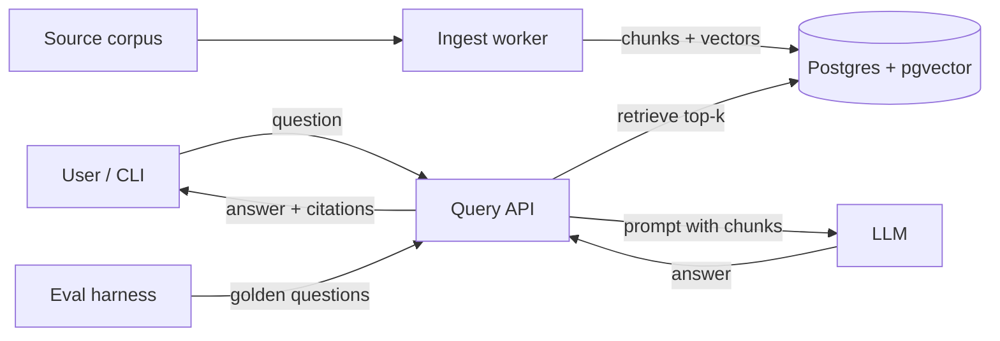

# Enterprise RAG Knowledge System

A small knowledge base that answers questions over a document corpus with cited sources. It uses the same patterns enterprise RAG systems rely on. This is mainly a learning project, and it stays small enough for one person to build in phases.

## Learning goals

By the end, I should be able to explain and demonstrate:

- How documents become searchable vectors (parsing, chunking, embedding, storage)
- How retrieval quality is measured and improved with an evaluation set
- Why hybrid search and reranking beat pure vector search in practice
- How permission-aware retrieval keeps restricted content out of answers
- How to operate the system: incremental re-ingestion, logging, and debugging bad answers

## Scope

The system ingests a public corpus that resembles enterprise content and serves cited answers through an API. It runs locally in Docker.

**In scope**

- One public corpus with mixed formats (Markdown, HTML, PDF). Examples: an open-source project's docs and issues, a public company handbook, or a few companies' SEC filings
- Incremental ingestion with metadata on every chunk
- A query API that returns answers with citations to source chunks
- An evaluation set and scoring script
- Hybrid search, reranking, permission filtering, and query logging in later phases

**Out of scope**

- A polished web UI (a minimal page or CLI is enough)
- Real authentication or SSO; permissions are simulated with test users and groups
- Connectors to live SaaS systems such as Confluence, SharePoint, or Slack
- Cloud deployment, autoscaling, and multi-tenant isolation
- Fine-tuning models

## Architecture

Two pipelines share one database. Ingestion writes chunks into Postgres, and the query path reads them back to answer questions.

The eval harness scores the API's answers on every change.

## Components

Four components, each testable on its own.

### 1. Ingest worker

Starts as a CLI and later becomes a scheduled job. It is idempotent: re-running it only processes what changed.

1. Discover documents in the source and record the URI and last-modified time
2. Hash content (SHA-256) and skip documents whose hash hasn't changed
3. Parse to clean text, preserving headings and structure
4. Chunk on headings, then by size (about 300 to 800 tokens, 10 to 15% overlap). Prepend the section path to each chunk before embedding
5. Embed in batches and record the embedding model name per chunk
6. Upsert in one transaction: delete the document's old chunks, insert the new ones, update the hash
7. Prune documents that disappeared from the source

Failures are isolated per document and recorded in an ingest run log. Parsed text is stored, so re-chunking or re-embedding doesn't require re-parsing.

### 2. Database

Postgres with pgvector. Holds documents, chunks, vectors, metadata, and run logs. Postgres full-text search supplies the keyword side of hybrid search in v2.

### 3. Query API

FastAPI. Embeds the question, retrieves the top-k chunks, builds a prompt that requires citations, calls the LLM, and returns the answer plus cited sources. Hybrid retrieval, reranking, permission filters, and logging come in later phases.

### 4. Evaluation harness

A script. Runs a set of golden questions through the API and reports retrieval hit rate and answer correctness, so every change can be measured against a baseline.

## Data model

Three core tables. Later phases add columns or JSONB keys rather than new structure.

| Table | Key columns | Purpose |
| --- | --- | --- |
| `documents` | id, source_uri, title, doc_type, owner, content_hash, parsed_text, updated_at | One row per source document; the hash drives incremental ingestion |
| `chunks` | id, document_id, chunk_index, section_path, text, embedding (vector), embedding_model, metadata (JSONB) | The retrievable unit; metadata later holds access groups |
| `ingest_runs` | id, started_at, finished_at, seen, skipped, updated, deleted, failed, errors (JSONB) | Audit trail for each ingestion run |

v3 adds a `query_log` table (question, user, retrieved chunk ids, latency, token cost, answer).

## Roadmap

There are three phases, and each ends with a measurable gate on the evaluation set. A phase doesn't start until the previous gate is met. The phases are broken into learning-sized issues in [docs/learning-path.md](docs/learning-path.md).

| Phase | Deliverables | Exit gate |
| --- | --- | --- |
| v1: Baseline RAG | Docker Compose with Postgres and pgvector; schema; ingest CLI with hashing, structure-aware chunking, and pruning; `/query` endpoint with cited answers; 30 to 50 golden questions and a scoring script | Full corpus ingests and re-runs skip unchanged docs; baseline eval scores recorded |
| v2: Retrieval quality | Postgres full-text search; hybrid retrieval with reciprocal rank fusion; a reranker; side-by-side eval report | Hybrid plus rerank beats the v1 baseline on retrieval hit rate |
| v3: Enterprise controls | Access groups on chunks; query-time permission filtering; test users at three permission levels; query logging with latency and cost | Zero restricted chunks returned to unauthorized test users; every query traceable in logs |

## Evaluation

Every design change is judged against a fixed golden set of 30 to 50 questions, written before any tuning starts.

Each golden question records the question, the expected answer, and the source documents that contain it. Some questions should have no answer in the corpus, so refusals get tested too.

Metrics tracked per run:

- **Retrieval hit rate @5**: share of questions where a correct source appears in the top 5 chunks
- **Answer correctness**: graded pass/fail, by hand at first, optionally by an LLM judge later
- **Citation accuracy**: share of cited chunks that actually support the answer
- **Permission leakage** (v3): restricted chunks returned to unauthorized users; the target is zero
- **Latency and cost per query** (v3)

Target numbers get set after the v1 baseline is measured.

## Tech stack

The stack uses tools common in enterprise deployments and keeps the number of moving parts low.

| Area | Choice | Why |
| --- | --- | --- |
| Language | Python | Dominant ecosystem for RAG and ML tooling |
| Vector store | Postgres with pgvector | Many companies already run Postgres; vectors, metadata, and full-text search in one place |
| API | FastAPI | Lightweight, typed, easy to test |
| Embeddings | Local sentence-transformers model to start | Free and fast to iterate on; swap for a hosted model later to compare |
| Parsing | Markdown natively; pymupdf or trafilatura for PDF/HTML | Parsing quality strongly affects retrieval |
| LLM | Any hosted LLM API | Only used for the final answer step |
| Packaging | Docker Compose | Reproducible local setup |

Deliberate decisions:

- No orchestration framework (LangChain, LlamaIndex) in v1, so I understand each step before abstracting it
- Store the embedding model name with every vector so re-embedding is safe
- Keep parsing separate from embedding so either can change on its own
- Optional later experiment: swap pgvector for a dedicated vector database (Qdrant or Weaviate) and compare

## Open questions

- [ ] Which corpus? It needs mixed formats, some natural access boundaries (for example, internal vs. public sections), and enough volume to make retrieval non-trivial (a few hundred documents).
- [ ] Time budget: how many hours per week, and a target date for each phase gate?
- [ ] Which LLM provider and embedding model, and is there a monthly cost ceiling?
- [ ] Is a minimal web UI wanted, or is a CLI enough for all phases?
- [ ] Should v3 include an LLM-as-judge for answer grading, or stay with manual grading?

## Working principles

- Treat this as a learning project: each work item names the concept it teaches, not just what it builds.
- Break each phase into tasks small enough to finish in one sitting, each with acceptance criteria tied to the eval metrics.
- Keep the phase gates. They are the main defense against tuning without measuring.
- Check any new scope against the out-of-scope list instead of quietly absorbing it.
